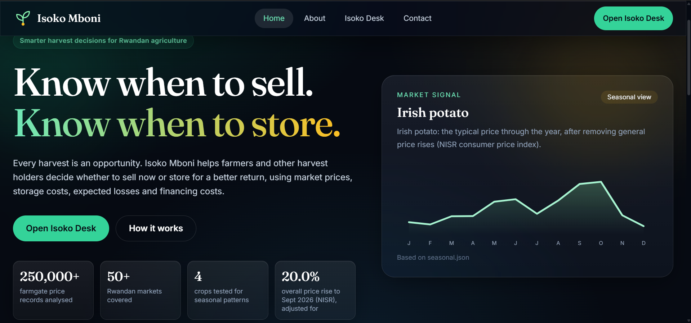
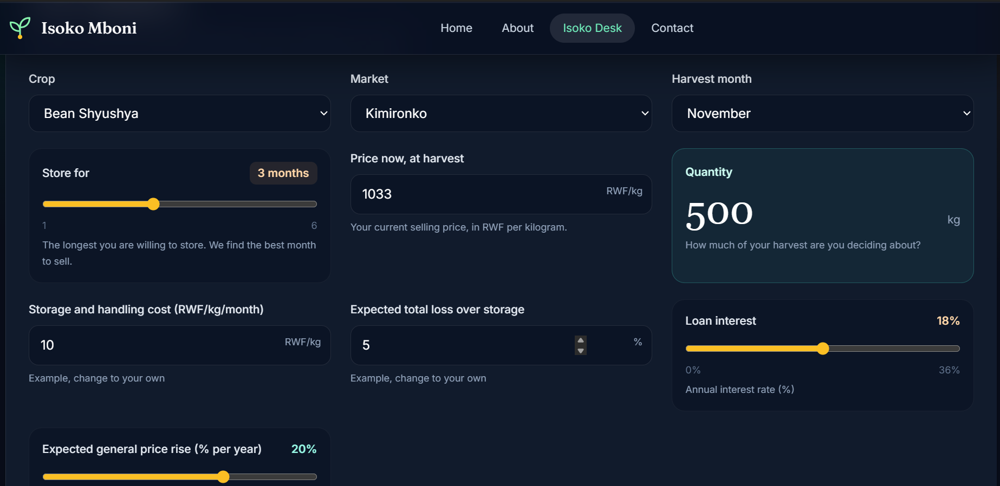
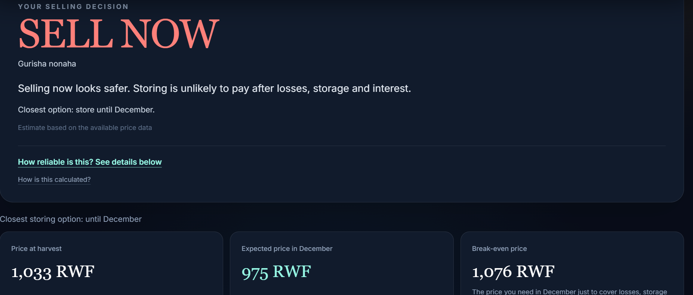
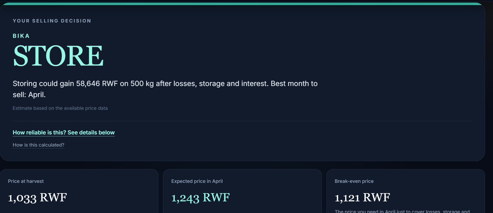
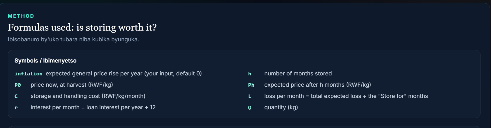
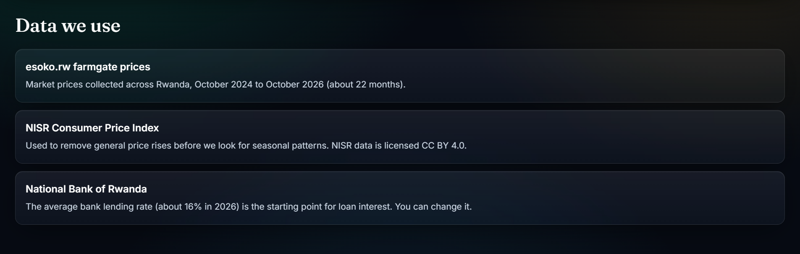
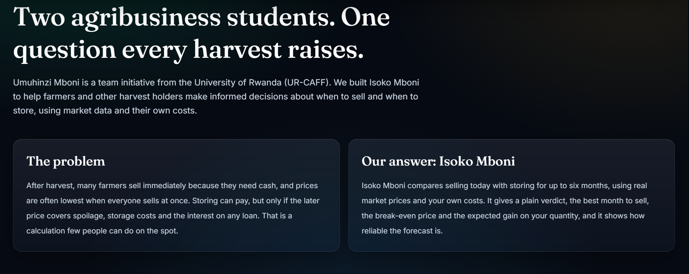

# Isoko Mboni

**Sell now or store? A plain-language decision tool for Rwandan crops.**

Built by team **Umuhinzi Mboni** (University of Rwanda, UR-CAFF) for the **NISR 2026 Big Data Hackathon**, Track 1: Agricultural Productivity.

- **Live app:** https://isoko-mboni.vercel.app
- **Open the dashboard directly:** https://isoko-mboni.vercel.app/#desk
- **Full methodology:** [docs/METHODOLOGY.md](docs/METHODOLOGY.md)
- **A demo on how to use this platform to compare sell or store decisions:** https://youtu.be/OdMZu1DDvNE?si=00ba336oakdSlPct


_Figure 1. The Isoko Mboni home page. The "Market signal" card shows the inflation-adjusted seasonal price pattern for Irish potato, built from the esoko.rw price records and the NISR consumer price index._

---

## The problem

**Rwanda loses 13.8% of what its farmers grow after harvest. The target is below 5% by 2029.**

That figure is the national post-harvest loss rate recorded in 2023. The Second National Strategy for Transformation (NST2, 2024 to 2029) commits to cutting it to under 5%, mainly through better handling, storage, market linkages and agro-processing. Reaching that target depends on millions of small decisions made at household and cooperative level, and one of the most important comes right after harvest:

> **Do I sell today at the harvest price, or store and wait for a better one?**

It is a hard decision for three reasons.

1. **Cash pressure pushes farmers to sell early.** Many farmers need money immediately, and prices tend to be lowest when everyone sells at once.
2. **Waiting is not automatically profitable.** A later price only pays if it is high enough to cover spoilage, storage and handling costs, and the interest on any loan.
3. **Almost nobody can do that calculation on the spot.** Without a clear comparison, farmers either sell too early and miss income, or store too long and lose money.

### What that looks like in real numbers

Take a farmer with **500 kg of beans** at a harvest price of **1,033 RWF/kg** (about 516,500 RWF), a storage cost of 10 RWF/kg/month, 5% expected loss and an 18% loan:

- Storing until **December** is _not_ worth it: the expected price (**975 RWF**) is below the break-even price (**1,076 RWF**). The right answer is **SELL NOW**.
- Storing until **April** _is_ worth it: the expected price (**1,243 RWF**) is above the break-even price (**1,121 RWF**). The tool estimates a gain of **58,646 RWF**, about 11% of the harvest-day value.

Same farmer, same crop, same harvest price. The best decision flips depending on the storage period, and nothing in the market price alone tells the farmer which side of the line they are on. See [Figures 3 and 4](#what-the-answer-looks-like).

### Why a decision tool, and why now

We tested whether seasonal price patterns are predictable enough to guide this decision, using **252,986 farmgate price records** from esoko.rw and the NISR consumer price index (which rose **20.0%** in the 12 months to September 2026, so raw prices alone are misleading). The answer is _sometimes_:

| Crop         | Our forecast error | Error if prices never change | Verdict                    |
| ------------ | ------------------ | ---------------------------- | -------------------------- |
| Irish potato | 13.9%              | 17.3%                        | Seasonal pattern is useful |
| Beans        | 7.1%               | 8.3%                         | Seasonal pattern is useful |
| Maize        | 13.6%              | 14.3%                        | Not reliable               |
| Rice         | 16.0%              | 5.2%                         | Not reliable               |

Two lessons follow. Storage can pay for some crops, and a tool that pretended to forecast every crop would be misleading. So **Isoko Mboni turns the decision into an economic comparison** and is honest about reliability: for maize and rice it shows no invented seasonal gain, a wide range and a "low confidence" label, so the answer is driven by the user's own costs.

The aim is not to promise higher prices or remove market risk. It is to make the trade-offs visible **before** a decision is made.

### How this connects to Rwanda's development agenda

| National priority                                                     | What it asks for                                                                                              | How Isoko Mboni contributes                                                                                                                    |
| --------------------------------------------------------------------- | ------------------------------------------------------------------------------------------------------------- | ---------------------------------------------------------------------------------------------------------------------------------------------- |
| **NST2 (2024 to 2029)**                                               | Cut post-harvest losses from 13.8% (2023) to below 5% by 2029; a more productive, market-oriented agriculture | Puts the loss rate into every decision: the user's expected storage loss is a direct input, and the tool shows what spoilage costs in RWF      |
| **PSTA 5 (2024/25 to 2028/29)**, the sector plan that implements NST2 | Inclusive markets and post-harvest management; stronger market linkages; digitized agri-food systems          | Turns public price data into a farm-level selling decision that works on a phone, with no backend and no sign-up                               |
| **Vision 2050**                                                       | A high-income economy by 2050, with agriculture as a source of inclusive wealth creation                      | Gives smallholders the same break-even logic traders and lenders already use, so more of the value created after harvest stays with the farmer |

Isoko Mboni works at the **decision-support level**. It does not build storage or roads, but it helps farmers, cooperatives and extension officers decide when storage is worth using, which is what makes post-harvest investment pay off.

---

## What Isoko Mboni does

You enter:

- crop and market
- harvest month and the longest you are willing to store (1 to 6 months)
- price now, and **quantity in kg**
- storage and handling cost (RWF/kg/month)
- expected total loss over storage (%)
- loan interest (% per year)
- optional: the general price rise you expect, and cash you need now


_Figure 2. Isoko Desk inputs. This example: Bean Shyushya at Kimironko market, harvested in November, 500 kg at 1,033 RWF/kg, stored for up to 3 months with a 10 RWF/kg/month storage cost, 5% expected loss and 18% loan interest. Costs are examples to be replaced with the user's own._

### What the answer looks like

You get an answer in plain language: **STORE** or **SELL NOW**, a sentence such as _"Storing could gain X RWF on Q kg after losses, storage and interest. Best month to sell: M."_, the expected price in that month, the **break-even price**, expected spoilage, the downside if prices disappoint, the chance that storing pays, and a clear statement of how reliable the forecast is.


_Figure 3. A SELL NOW result. The expected December price (975 RWF) is below the break-even price (1,076 RWF), so storing is unlikely to pay after losses, storage and interest. The tool shows the "closest storing option" so the user can see how near it came._


_Figure 4. A STORE result. The expected April price (1,243 RWF) is above the break-even price (1,121 RWF), giving an estimated gain of 58,646 RWF on 500 kg. Both results show a "How reliable is this?" link and a "How is this calculated?" link, so no answer is a black box._

The numbers in this README are examples of the format. Every figure in the app is calculated from the inputs and the data.

## How it works

```
esoko.rw farmgate prices ----+
                             +--> Python pipeline --> 6 small JSON files --> React app (static site)
NISR consumer price index ---+
```

There is no backend. The Python pipeline cleans the prices, removes general inflation using the NISR consumer price index, finds the seasonal pattern and tests it against past months. It writes small JSON files that the web app reads. The sell-or-store calculation runs in the browser.

The calculation is shown to the user in English and Kinyarwanda, with every symbol defined, so an extension officer or cooperative leader can check it by hand.


_Figure 5. The in-app method panel ("Formulas used: is storing worth it?"). It defines every symbol: harvest price (P0), storage cost (C), monthly interest (r = annual rate ÷ 12), months stored (h), expected price after h months (Ph), monthly loss (L), quantity (Q) and expected general price rise._

## Data

| Data                                                                 | Source                                                       | Use                                                                                                                             |
| -------------------------------------------------------------------- | ------------------------------------------------------------ | ------------------------------------------------------------------------------------------------------------------------------- |
| Farmgate prices, 252,986 records                                     | esoko.rw prices API                                          | Seasonal price patterns. Usable window: October 2024 to October 2026 (about 22 months, with no data for August to October 2025) |
| Consumer Price Index, All Rwanda, Feb 2014 = 100 (Sept 2026 release) | National Institute of Statistics of Rwanda (NISR), CC BY 4.0 | Removes general price rises from the price history. The index rose 20.0% over the 12 months to September 2026                   |
| Average bank lending rate, about 16% in 2026                         | National Bank of Rwanda                                      | Default for the loan-interest input (the user can change it)                                                                    |


_Figure 6. The "Data we use" section of the app. Each source is named with its role in the model and its licence where it applies._

The raw price download is **not** in this repository because it contains personal details of price collectors. [docs/METHODOLOGY.md](docs/METHODOLOGY.md) explains how to rebuild everything.

## What our testing found

For each of four storable staple crops we asked: _does last year's seasonal price change predict this year's better than assuming prices never change?_ The results are in the table in [the problem section](#why-a-decision-tool-and-why-now).

A crop counts as reliable only if its error is at least 10% below the "no change" error. We chose that margin after seeing the results, and we say so in the methodology. For maize and rice the app does **not** invent a seasonal gain: it shows a zero expected change with a wide range and a "low confidence" label, and the answer is then driven by your own costs.

These tests are preliminary: they use only about 22 months of data, and the individual tests overlap.

## Limits (please read)

- **Short history.** About 22 months of prices with a three-month gap. Seasonal patterns from so little data are weak, and most forecasts are labelled low confidence.
- **National pattern, not per market.** The seasonal outlook is national. Prices at your market may differ.
- **The price range is approximate.** The low and high prices come from how well last year's pattern predicted this year's, not from exact price statistics.
- **Your costs are your inputs.** We have no verified data on storage cost or spoilage. The defaults are examples to be changed. For reference, the national post-harvest loss rate was 13.8% in 2023 and the 2029 government target is below 5%.
- **Inflation adjustment is broad.** We use the all-items consumer price index, not a food-only index, so a small part of real seasonal movement may be removed.
- **Prototype.** Results are estimates, not financial advice.

## Alignment with national priorities

- **NST2 (2024 to 2029):** targets post-harvest losses below 5% by 2029 (from 13.8% in 2023) and a more market-oriented, productive agriculture, with investment in handling, storage, value chains and market access.
- **PSTA 5 (2024/25 to 2028/29):** the agriculture sector plan that implements NST2 and is aligned with Vision 2050. Its priorities include inclusive markets and post-harvest management, with an explicit output on post-harvest handling for reduced losses.
- **Vision 2050:** Rwanda's path to an upper-middle-income economy by 2035 and a high-income economy by 2050, with agriculture as a source of inclusive wealth creation.

Isoko Mboni supports these goals by helping farmers, cooperatives and traders make an informed storage and selling decision, and by showing clearly what storing costs.

Sources:

- MINAGRI, PSTA 5 (abridged): https://www.minagri.gov.rw/fileadmin/user_upload/Minagri/Publications/Policies_and_strategies/PSTA_5_Abridged_version_Final.pdf
- NST2 post-harvest loss target (13.8% in 2023 to below 5% by 2029): https://allafrica.com/stories/202508130166.html
- NST2 agriculture priorities: https://newtimes.co.rw/article/20046/news/agriculture/nst2-how-govt-plans-to-drive-agriculture-forward
- NISR Consumer Price Index (CC BY 4.0): https://statistics.gov.rw

## Who can use it

- **Smallholder farmers and cooperatives:** decide when to sell, and how much to sell now to cover cash needs.
- **Traders and aggregators:** see what a storage period has to earn to cover costs.
- **Extension officers:** explain storage economics with the farmer's own numbers.
- **Planners and policy teams:** see how loan interest and spoilage change the case for storage.

We have not yet tested the tool with farmers. That is the next step.

## How this maps to the judging criteria

| Criterion                           | Where to look                                                                                                                                                                             |
| ----------------------------------- | ----------------------------------------------------------------------------------------------------------------------------------------------------------------------------------------- |
| Problem understanding and relevance | "The problem" and "Alignment" above; About page in the app (Figure 7)                                                                                                                     |
| Data use and methodology            | "Data" and "What our testing found" above; [docs/METHODOLOGY.md](docs/METHODOLOGY.md): cleaning rules, NISR CPI adjustment, backtest, formulas                                            |
| Tech innovation                     | Inflation-adjusted seasonal forecasts with a backtest and a stated reliability rule; a decision model with break-even price, probability that storing pays, downside check and cash split |
| Usability and design                | Isoko Desk: inputs on the left and all results visible on one screen; plain-language answers; English and Kinyarwanda; mobile layout                                                      |
| Tangible impact                     | "Who can use it" above; works from public data and costs the user knows                                                                                                                   |

## Run it locally

Web app:

```
npm install
npm run dev        # http://localhost:5173
npm run build      # production build
```

Rebuild the data (Python 3.10 or newer):

```
cd pipeline
pip install -r requirements.txt
python fetch_prices.py       # downloads about 253,000 rows to data/raw_prices.jsonl (resumable)
python check_crops.py        # converts to data/raw_prices.pkl and prints coverage per crop
# download the NISR CPI file and save it as pipeline/data/CPI_time_series_September_2026.xls
python build_data.py         # writes pipeline/out/*.json
# copy the JSON files from pipeline/out into web/public/data/
```

NISR CPI file: https://statistics.gov.rw/sites/default/files/documents/2026-10/CPI_time_series_September_2026.xls

## Repository structure

```
pipeline/    Python: download, cleaning, CPI adjustment, seasonal outlook, backtest, JSON export
web/         React + TypeScript + Vite + Tailwind CSS + Recharts
  public/data/   the JSON files the app reads
  src/lib/decision.ts   the sell-or-store calculation
docs/        METHODOLOGY.md
  images/    screenshots used in this README
```

Stack: Python (pandas, numpy), React, TypeScript, Vite, Tailwind CSS, Recharts, deployed on Vercel.

## Tools and AI assistance

We used AI assistants (Claude by Anthropic and ChatGPT) to help write and review code and documentation. The problem choice, data sources, modelling decisions and the reliability rules are ours, and the results reported here come from running the code in this repository.

### AI-Assisted Development and Human Oversight

AI tools were integrated into the development workflow as technical support, while the project's direction, core decisions and implementation remained under the responsibility of the team.

- **Claude (Anthropic):** Assisted with agricultural price-data analysis, pandas-based data processing, debugging and refining data-analysis workflows.
- **ChatGPT (OpenAI):** Assisted with React and TypeScript UI debugging, interface refinements, component improvements and frontend problem-solving.

The team used these tools to accelerate experimentation, troubleshoot technical challenges and improve development efficiency. AI-generated suggestions and code were reviewed, adapted and tested before adoption. Data-source selection, analytical assumptions, decision-model design, interpretation of results and final project decisions remained team responsibilities.

**Our approach:** AI accelerated the development process; human judgment remained responsible for the product. Isoko Mboni is a team-led decision-support solution, not an AI-generated price prediction system. Its recommendations are based on documented agricultural price data, explicit economic assumptions and transparent decision rules.

## Team

**Umuhinzi Mboni**, an initiative of two agribusiness students at the University of Rwanda (UR-CAFF): **J.Claude** and **Etienne**. Use the Contact page in the app to reach us.


_Figure 7. The About page of the app, summarising the problem (farmers sell early for cash, when prices are lowest) and the team's answer._

## Credits

Price data: esoko.rw. Consumer price index: National Institute of Statistics of Rwanda (NISR), licensed CC BY 4.0. Lending rate reference: National Bank of Rwanda.

_Last updated 4 November 2026._
